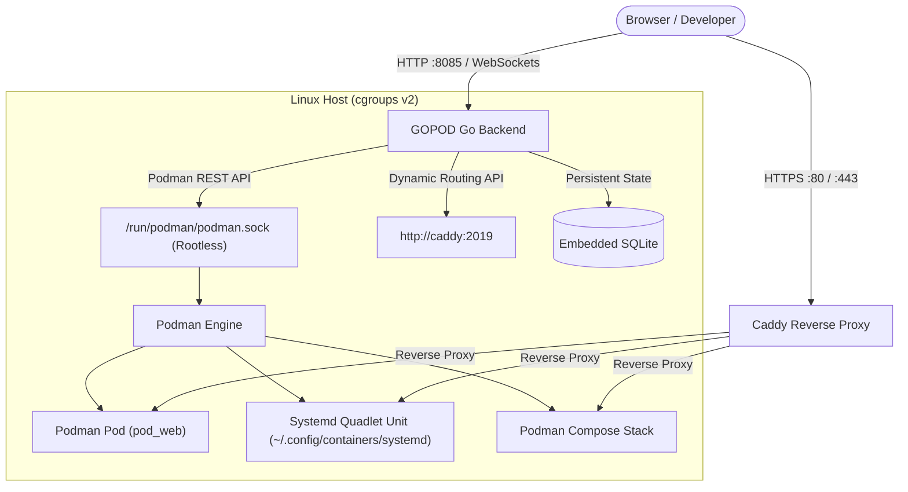

# GOPOD 🚀

> **The Modern, Daemonless, Podman-Native Platform-as-a-Service (PaaS).**  
> Lightweight, secure by design, and built natively for Linux cgroups v2, Podman rootless sockets, Quadlet systemd units, and Caddy ingress.

[](LICENSE)
[](https://podman.io)
[](https://go.dev)
[](https://svelte.dev)
[](https://caddyserver.com)

---

## 💡 Inspiration & Philosophy

GOPOD exists because platforms like **Dokploy** proved that self-hosted PaaS can feel effortless. That said, GOPOD is an **independent implementation**: it runs a different engine (Go, embedded SQLite, rootless Podman, systemd Quadlet, Caddy) and shares no codebase with any existing platform. There is no affiliation with Dokploy or Cloudflare.

Existing self-hosted PaaS solutions rely strictly on the rootful Docker daemon (`/var/run/docker.sock`), which brings along daemon SPOFs (single point of failure), root privileges, and high idle memory footprints that quickly saturate budget VPS instances (1GB–2GB RAM). Furthermore, none provided first-class support for native Podman features.

**GOPOD** was created to bridge this gap:
- **Inspired by Proven Workloads**: Taking the best, most essential developer workflows from platforms we've used and loved, distilled down into a focused, high-performance core for this phase.
- **Ultra-Low Memory Footprint**: Built with a single Go binary, embedded SQLite, Caddy 2, and SvelteKit 5—idling at **<100MB RAM total**, making it effortless to run on small, economical VPS servers.
- **Rootless by Default**: Interacts directly with rootless Podman user sockets (`/run/user/$UID/podman/podman.sock`). No root daemon privileges required.
- **First-Class Podman Pods**: Group related containers into real Podman pods sharing network namespaces and localhost loopbacks.
- **Native Systemd Quadlet**: Deploy declarative `.container` and `.pod` units managed directly by `systemd --user` for rock-solid service supervision and auto-restart on host boot.
- **Zero-Touch Ingress with Caddy**: Dynamic Let's Encrypt TLS certificates, automated reverse proxying on `gopod-net`, and WebSocket passthrough without manual Nginx reloads.
- **Multi-Workload Parity**: Full support for Container Images, Git repositories (Dockerfile), Docker Compose, Kubernetes manifests (`podman kube play`), and Systemd Quadlets.

---

## 🏛️ Architecture



---

## ⚡ Features

| Feature | Description |
|---|---|
| **Rootless Podman Native** | Direct integration with `libpod` REST API via user socket; zero daemon overhead. |
| **Systemd Quadlet Supervised** | Generates native systemd service units for containers with systemd reliability. |
| **Podman Pods** | Co-locate microservices and databases inside shared network pods (`localhost:port`). |
| **Caddy 2 Dynamic Ingress** | Automatic Let's Encrypt SSL/TLS, custom domain routing, and instant zero-downtime updates. |
| **Modern PaaS Lifecycle** | Fresh volumes rollout, instant rebuild, stop/start container lifecycle, and branch autodeploy. |
| **Live Telemetry & Logs** | Streaming container logs via WebSockets and real-time CPU/Memory charts. |
| **Web Terminal Console** | Interactive exec terminal into any running container right in the browser. |
| **Centralized Credentials** | Reusable Git SSH deploy keys and private container registry authentication. |

---

## 🚀 Quick Start

### 1. Prerequisites
Ensure you have **Podman** installed with the user socket enabled:
```bash
# Enable rootless podman socket
systemctl --user enable --now podman.socket

# Verify socket is active
ls -l /run/user/$UID/podman/podman.sock
```

### 2. Launch with Podman Compose
Clone the repository and start GOPOD with the provided development compose file:
```bash
git clone https://github.com/your-org/gopod.git
cd gopod

# Copy example environment configuration
cp .env.example .env

# Start GOPOD and Caddy reverse proxy
podman compose -f compose.dev.yml up -d --build
```

Access the web interface at **`http://localhost:8085`** or via Caddy at **`http://localhost:8080`**.

---

## 📁 Repository Structure

```
gopod/
├── backend/                  # Go Backend Service
│   ├── cmd/server/           # Application entrypoint
│   └── internal/
│       ├── api/              # HTTP REST handlers (projects, services, deploy, telemetry)
│       ├── db/               # SQLite database queries and migrations
│       ├── podman/           # Podman REST API client & Quadlet generator
│       ├── proxy/            # Caddy dynamic config client
│       └── server/           # Router & WebSocket server
├── frontend/                 # SvelteKit 2 + Svelte 5 Web UI
│   ├── src/
│   │   ├── lib/
│   │   │   ├── components/   # Modular UI hierarchy (primitives, ui, features)
│   │   │   ├── stores/       # Reactive Svelte state stores
│   │   │   └── api/          # Typed API client
│   │   └── routes/           # File-based routing (projects, services, monitoring)
├── caddy/                    # Caddy reverse proxy configuration
├── compose.dev.yml           # Local development stack
├── compose.yml               # Production deployment definition
└── Dockerfile                # Multi-stage production container build
```

---

## 🛠️ Local Development (Hot Reload, No Containers Needed)

You do **not** need to rebuild containers or wait for `podman compose` during day-to-day development. You can run the Frontend (Vite HMR) and Backend (Go) directly on your host machine for instantaneous (<50ms) feedback.

### 1. Prerequisites
Ensure your local rootless Podman user socket is running:
```bash
# Enable rootless podman socket (one-time setup)
systemctl --user enable --now podman.socket

# Verify socket exists
ls -l /run/user/$UID/podman/podman.sock
```

---

### 2. Terminal 1: Backend (Go API)

The backend connects directly to your host's rootless Podman socket (`/run/user/$UID/podman/podman.sock`) and automatically uses the shared `./data/gopod.db` database.

#### Option A: Direct Go Run
```bash
cd backend
PORT=8000 go run ./cmd/server
```

#### Option B: Hot Reload with [Air](https://github.com/air-verse/air) (Auto-restarts on code save)
```bash
# 1. Install Air tool (one-time)
go install github.com/air-verse/air@latest

# 2. Run with Air (uses backend/.air.toml)
cd backend
air
```

Backend will be available on **`http://localhost:8000`**.

---

### 3. Terminal 2: Frontend (SvelteKit + Vite HMR)

Vite is preconfigured with an automatic reverse proxy in `frontend/vite.config.ts` that forwards all `/api/*` and WebSocket connections directly to `http://localhost:8000`.

```bash
cd frontend
npm install # or bun install
npm run dev # or bun run dev
```

* Open your browser at **`http://localhost:5173`**.
* Every edit to `.svelte`, `.css`, or `.ts` files updates **instantly** (<50ms) via Hot Module Replacement without page reload and without touching any container!

---

### 4. Supporting Infrastructure: Caddy Reverse Proxy (Optional)

If you are developing or testing ingress routing, domain SSL, and access log streaming, leave Caddy running in the background:
```bash
# Start only the Caddy reverse proxy in background
podman compose -f compose.dev.yml up -d caddy
```
Caddy exposes its Admin API on `127.0.0.1:2019`, so your local Go backend running via `air` or `go run` can seamlessly sync Caddyfiles and read live access logs from `./caddy/logs/access.log`.

---

### 4. Full-Stack Container Testing (Optional)

When you want to validate Caddy reverse proxy integration, production builds, or multi-container parity:
```bash
podman compose -f compose.dev.yml up -d --build
```
Access at `http://localhost:8085` or via Caddy at `http://localhost:8080`.

---

### 5. Type-Check & Production Build Validation
```bash
cd frontend

# Run Svelte and TypeScript checks
npm run check

# Verify production static build
npm run build
```

---

## 📄 License

Copyright 2026 Ijon6k.

GoPod is licensed under the [GNU Affero General Public License v3.0](LICENSE) — SPDX identifier `AGPL-3.0-only`. The LICENSE file is a byte-identical copy of the official text published by GNU.

Releases prior to the AGPL-3.0 relicense were distributed under the MIT License ("Copyright (c) 2026 gopod contributors" — a single-author project). That grant remains in effect for those historical releases; this repository does not revoke previously-granted MIT permissions.

Official repository: https://github.com/ijon6k/gopod, maintained by Ijon6k. Forks must carry their own project identity and must not present modified builds as the official GoPod release.

GoPod serves users over a network. Operators running modified builds must offer every user of that deployment the Corresponding Source of their version, as required by AGPL-3.0 section 13. To make this practical, the server exposes `GET /api/about`, which reports the license identifier, the upstream source location, and the VCS revision of the running build.
