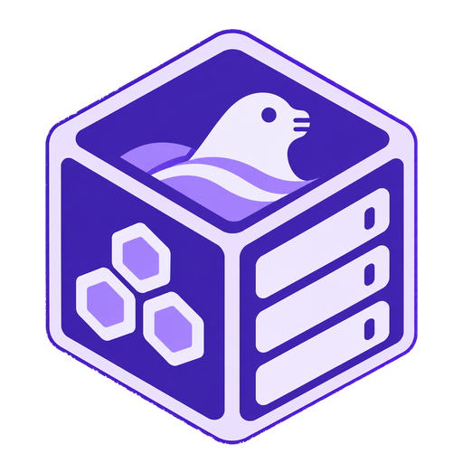
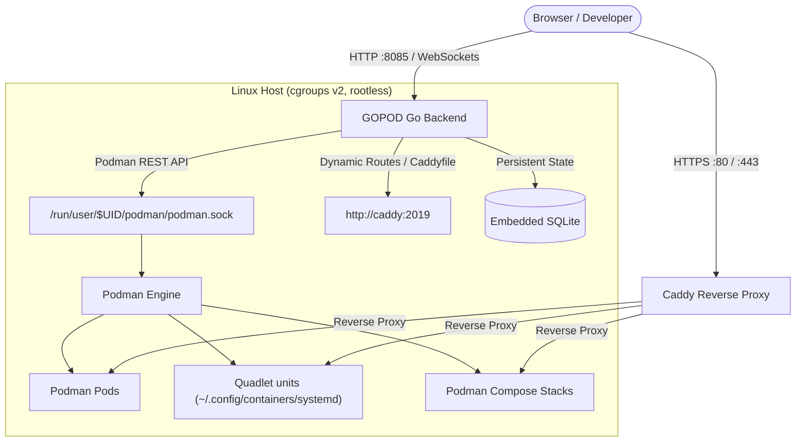

<div align="center">
  
  <h1>GOPOD</h1>
  <p><strong>Self-hosted, Podman-native PaaS for Linux.</strong><br/>
  Rootless containers, systemd Quadlets, and Caddy ingress behind a single Go binary.</p>

[](LICENSE)
[](https://podman.io)
[](https://go.dev)
[](https://svelte.dev)
[](https://caddyserver.com)
</div>

## Screenshots

| Projects                                                                                                                     | Service (compose stack)                                                                                                     |
| ---------------------------------------------------------------------------------------------------------------------------- | --------------------------------------------------------------------------------------------------------------------------- |
|  |  |
|              |               |

## Background

There are good self-hosted PaaS platforms already. [Dokploy](https://github.com/Dokploy/dokploy) proved that this category can feel effortless, and this project borrows many of its workflows on purpose. To be equally clear about what GOPOD is not: it is an independent implementation. It shares no code, runtime, or build with Dokploy, and there is no affiliation or endorsement in either direction.

The user interface is built on [Kumo](https://github.com/cloudflare/kumo-svelte), Cloudflare's internal design system, published as open source. Credit where it belongs; the visual language is theirs, the application code is not.

The technical reason GOPOD exists: almost every self-hosted PaaS is built on the rootful Docker daemon (`/var/run/docker.sock`). That one dependency buys you a root-privileged daemon, a single point of failure in `dockerd`, and an idle memory footprint that is awkward to carry on a 1–2 GB VPS. None of them treat Podman's native features as first-class. GOPOD does the opposite: it talks to the rootless Podman socket as the primary interface, and treats `systemd --user` as the supervisor of record.

## What GOPOD does

- **Rootless Podman as the engine** — everything goes through the libpod REST API on the user socket (`/run/user/$UID/podman/podman.sock`). No root daemon, no `dockerd`.
- **Quadlet, first-class** — services can be declarative `.container` / `.pod` units supervised by `systemd --user`, edited from a structured UI, with restart-on-boot for free.
- **Podman pods** — group related containers into real pods sharing a network namespace and localhost.
- **Docker Compose stacks** — validated inline compose editor, deploy with Netavark networking on `gopod-net`, or encapsulate the stack inside a Podman pod.
- **Kube manifests** — `podman kube play` for declarative YAML workloads.
- **Git-based applications** — build from a Git repo with a Dockerfile, branch autodeploy, signed provider webhooks, and re-deploy of any past build. Optional fresh-volume rollouts.
- **Managed databases** — templated engine images (Postgres and friends) with sane defaults.
- **Caddy ingress** — per-service domains with automatic Let's Encrypt TLS, basic auth, WebSocket pass-through, and custom routing/middleware options driven through the Caddy admin API.
- **Operate, watch, debug** — live CPU/RAM/storage telemetry over SSE, per-workload resource tree, interactive topology graph, streaming build and container logs, browser exec/terminal, shell access, and a full audit log.
- **Centralized credentials** — reusable Git SSH deploy keys, personal access tokens, and private registry credentials.
- **Small by construction** — one Go binary with embedded SQLite plus two small containers; it idles well under ~100 MB, which is what makes a 1–2 GB VPS realistic.

## Known limitations

Stated plainly, because marketing-driven READMEs are exhausting:

- Compose stack manifests are edited inline — pulling a compose file from a Git repository is not implemented yet. Use _Application_ (Git) services for Git-based builds.
- Builds run from Dockerfiles only; there is no buildpack autodetect.
- The dashboard currently assumes a single administrator. There are no teams, roles, or granular permissions.

## Requirements

- Linux with systemd and cgroups v2 (Debian, Ubuntu, Arch, Rocky, Alpine — anything with a systemd user manager).
- Podman 5.x rootless, user socket enabled:
  ```bash
  systemctl --user enable --now podman.socket
  ```
- Internet access for Let's Encrypt if you want real certificates through Caddy.

## Quick start

The installer detects your distro and SELinux policy, enables the rootless socket, and installs GOPOD either as native Quadlet units (default) or via Podman Compose:

```bash
git clone https://github.com/ijon6k/gopod.git
cd gopod
./scripts/install.sh                 # quadlet mode (default)
./scripts/install.sh --mode=compose  # podman compose mode
```

Quadlet mode installs first-party units you can inspect under [`deploy/`](deploy) — `gopod-server.container`, `gopod.pod`, `gopod-caddy.container`, `gopod-net.network` — and manages them with plain `systemctl --user`.

Prefer doing it by hand:

```bash
cp deploy/gopod-net.network ~/.config/containers/systemd/
# ...or simply:
podman compose up -d --build
```

After that:

- Dashboard: `http://<host>:8085` (first visit opens the setup wizard, one admin account).
- Caddy ingress: `:80` / `:443` for your service domains.

## Development

Day-to-day development does not need the container path. The backend is a plain Go server; the frontend is SvelteKit with Vite HMR proxying `/api` and WebSockets to it.

```bash
# optional, only if you need Caddy locally (admin API + access logs):
podman compose -f compose.dev.yml up -d caddy

cd backend && go run ./cmd/server          # or: air   (uses .air.toml)
cd frontend && bun install && bun run dev  # http://localhost:5173, HMR to :8085
```

Quality gates expected on every change:

```bash
cd frontend && bun run check && bun run lint   # typecheck + prettier + eslint
cd backend  && go vet ./... && go test ./...   # includes the integration suite
```

Frontend work must follow the [UI standards](AGENTS.md): semantic tokens from `app.css` only, no hardcoded colors, English copy.

## Architecture



## Repository layout

```
gopod/
├── backend/                  # Go 1.26, single binary
│   ├── cmd/server/           # entrypoint
│   ├── internal/
│   │   ├── services/         # projects, services, deployments, logs (SQLite)
│   │   ├── podman/           # libpod REST client (containers, images, volumes, networks)
│   │   ├── runtime/          # exec/streams, quadlet units
│   │   ├── ingress/          # Caddy route generation + reconciliation
│   │   ├── storage/          # volume snapshots & backups
│   │   ├── credentials/      # deploy keys, PATs, registry auth
│   │   ├── auth/             # sessions, rate limiting
│   │   ├── server/           # router, middleware, static SPA
│   │   ├── activity/         # engine events
│   │   └── audit/            # request audit trails
│   └── tests/integration/    # API-level integration suite
├── frontend/                 # SvelteKit 2 + Svelte 5 (runes), Tailwind 4, Bun
│   └── src/lib/components/   # kumo primitives + GOPOD feature components
├── caddy/                    # Caddyfile, TLS storage, access logs
├── deploy/                   # first-party Quadlet units for installing GOPOD itself
├── scripts/install.sh        # distro/SELinux-aware installer
├── compose.yml               # production container definition
└── compose.dev.yml           # development stack (dashboard + Caddy)
```

## Security

Security reports should go through [SECURITY.md](SECURITY.md) — private advisories, coordinated disclosure, please do not open a public issue.

Where your data and credentials live:

- All application state is in a local SQLite file (`./data/gopod.db` by default).
- Git keys, PATs, and registry credentials are stored server-side and never shipped to other users of the instance.
- The server maintains a strict query-token policy: session tokens are accepted only from headers, except where a browser API cannot set headers (two SSE endpoints and the exec websocket).

## License

Copyright 2026 Ijon6k.

GoPod is licensed under the [GNU Affero General Public License v3.0](LICENSE) — SPDX identifier `AGPL-3.0-only`. The LICENSE file is a byte-identical copy of the official text published by GNU.

Releases prior to the AGPL-3.0 relicense were distributed under the MIT License ("Copyright (c) 2026 gopod contributors" — a single-author project). That grant remains in effect for those historical releases; this repository does not revoke previously-granted MIT permissions.

Official repository: https://github.com/ijon6k/gopod, maintained by Ijon6k. Forks must carry their own project identity and must not present modified builds as the official GoPod release.

GoPod serves users over a network. Operators running modified builds must offer every user of that deployment the Corresponding Source of their version, as required by AGPL-3.0 section 13. To make this practical, the server exposes `GET /api/about`, which reports the license identifier, the upstream source location, and the VCS revision of the running build.
